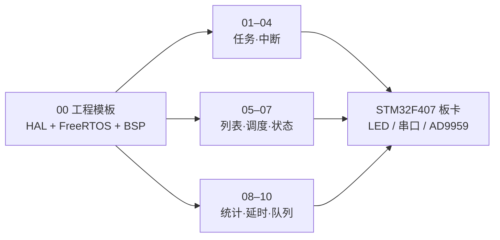

<div align="center">

# FreeRTOS 实验合集（STM32F407）

**十节课，一个模板：从建任务到队列，每个实验都能单独编译、单独烧录、单独观察**


[快速开始](#3-快速开始) · [实验对照表](#4-实验与知识点对照) · [全部仓库索引](https://github.com/xhtfps/xhtfps)

</div>

## 为什么按实验编号组织

FreeRTOS 的难点不在概念，而在**每个 API 的副作用**：动态创建会不会把堆吃光、挂起期间打印为什么停了、时间片到底切了没有。这里把每个知识点拆成一个独立工程，改一行、烧一次、看一眼现象，而不是塞进一个越写越乱的大工程。

## 亮点

- **00 模板 + 01–10 实验**：模板可直接复用做新工程，十节课各带 `User/` `Drivers/` `Middlewares/` 固定分层。
- **每节课都有观察点**：对照表里写清「关键 API → 该看什么现象」，不是跑通就算完。
- **命令行也能编译**：给出 `UV4.exe -b` 的构建命令，便于脚本化验证。
- **仓库干净**：`Output/`、`*.uvguix.*`、`JLinkLog.txt` 全部在 `.gitignore` 里，clone 下来没有别人的垃圾。

## 结构



## 1. 软硬件环境

| 项 | 要求 |
| --- | --- |
| 开发板 | 正点原子 探索者 STM32F407（工程名 `atk_f407`，板载 XMRAM、TFTLCD） |
| MCU | STM32F407ZGT6（168 MHz，1 MB Flash，192 KB SRAM） |
| IDE | Keil MDK-ARM 5.36 及以上（需装 `Keil.STM32F4xx_DFP` 器件包） |
| 调试器 | J-Link（推荐）/ ST-Link V2，SWD 接线：`SWCLK/SWDIO/GND/3V3` |
| 串口 | USART1，115200-8-N-1，用于 `printf` 重定向输出 |
| 依赖库 | STM32F4 HAL 驱动 + FreeRTOS（CMSIS-RTOS v1 封装），均已随仓库附带 |

## 2. 目录结构

```
freertos-labs/
├── 00_freertos_project_template/          # 工程模板：HAL + FreeRTOS + BSP(LED/KEY/AD9959/PS2/XMRAM)
├── 01_task_create_delete_dynamic/         # 实验01 动态创建与删除任务
├── 02_task_create_delete_static/          # 实验02 静态创建与删除任务
├── 03_task_suspend_resume/                # 实验03 任务挂起与恢复
├── 04_interrupt_management/               # 实验04 中断管理与临界区
├── 05_list_and_item_insert_delete/        # 实验05 列表与列表项插入/删除
├── 06_Time-Slice-Scheduling-Experiment/   # 实验06 时间片轮转调度
├── 07_Task-Status-Query/                  # 实验07 任务状态查询
├── 08_Task-Runtime-Statistics-API-Functions/ # 实验08 运行时间统计
├── 09_Delay-Function-Demonstration-Experiment/ # 实验09 延时函数对比
└── 10_Queue-Operations/                   # 实验10 队列收发与中断安全 API
```

单个工程的内部结构固定：

```
<工程>/
├── atk_f407.uvprojx   # Keil 工程入口（双击打开）
├── User/              # main.c、FreeRTOSConfig.h、应用代码
├── Drivers/           # HAL 库 + BSP 板级驱动
└── Middlewares/       # FreeRTOS 源码、CMSIS-RTOS 封装
```

## 3. 快速开始

1. 打开 Keil，`Project → Open Project`，选择目标实验目录下的 `atk_f407.uvprojx`。
2. `Project → Rebuild all target files`（首次必须全编译，仓库不含 `.o/.d/.crf` 中间产物）。
3. 连接 J-Link/ST-Link，`Flash → Download` 烧录。
4. 打开串口助手（115200），复位后观察打印；也可直接看板载 LED 现象。

命令行编译（可选）：

```powershell
& "C:\Keil_v5\UV4\UV4.exe" -b .\01_task_create_delete_dynamic\atk_f407.uvprojx -j0 -o build.log
```

## 4. 实验与知识点对照

| 实验 | 关键 API | 观察点 |
| --- | --- | --- |
| 01 | `xTaskCreate` / `vTaskDelete` | 任务创建删除次序、`xPortGetFreeHeapSize` 剩余堆 |
| 02 | `xTaskCreateStatic` | 静态分配不消耗 FreeRTOS 堆 |
| 03 | `vTaskSuspend` / `vTaskResume` | 挂起期间打印与 LED 停止 |
| 04 | `taskENTER_CRITICAL`、优先级分组 | 临界区内外中断响应时序 |
| 05 | `vListInsert` / `uxListRemove` | 节点顺序与 `uxNumberOfItems` |
| 06 | `configUSE_TIME_SLICING` | 同优先级任务交替执行 |
| 07 | `eTaskGetState` | 各任务状态枚举值 |
| 08 | `vTaskGetRunTimeStats` | 各任务 CPU 占用百分比 |
| 09 | `vTaskDelay` / `vTaskDelayUntil` | 相对延时的累积抖动 vs 绝对周期 |
| 10 | `xQueueSend` / `xQueueReceive` | 队列长度、阻塞超时与中断中 `FromISR` 版本 |

## 5. 常见问题

- **报错找不到 `FreeRTOS.h`**：确认 `Options for Target → C/C++ → Include Paths` 含 `Middlewares/FreeRTOS/include`；工程路径不要有中文/空格。
- **烧录提示 Cannot access target**：检查 SWD 四线接触与供电；J-Link 在 `Options → Debug → Settings` 里选 `SW`、速度降到 1 MHz 重试。
- **动态创建任务返回 `errCOULD_NOT_ALLOCATE_REQUIRED_MEMORY`**：在 `User/FreeRTOSConfig.h` 调大 `configTOTAL_HEAP_SIZE`（模板默认值适合 10 个以内小任务）。
- **中文注释乱码**：Keil `Edit → Configuration → Encoding` 改为 `UTF-8`。

## 6. 版本与维护

- 生成文件（`Output/`、`Objects/`、`Listings/`、`*.uvguix.*`、`JLinkLog.txt`、`keil_build.log`）一律不入库，见 `.gitignore`。
- 原独立仓库 `01_…`～`10_…` 与 `freertos_project_template` 已并入本仓库（按文件内容逐一比对，无遗漏源码），原仓库已归档不再维护。
- 新增实验：复制 `00_freertos_project_template`，按 `NN_<实验名>` 命名并补充上表。
## 路线图

- [x] 十个实验与模板并入同一仓库，按内容逐一比对无源码遗漏
- [x] 生成物清理与 `.gitignore` 兜底
- [ ] 给 08 运行时间统计补一版「串口表格输出」示例
- [ ] 把 AD9959 / PS2 等 BSP 依赖收敛到 `bsp-libs`

## 参与与反馈

- 遇到问题请走 [Issue 模板](.github/ISSUE_TEMPLATE)，附上实验编号与完整编译日志。
- 提 PR 前先读 [CONTRIBUTING.md](CONTRIBUTING.md)；安全问题按 [SECURITY.md](SECURITY.md) 私下反馈。
- 如果这个仓库帮你省过时间，点个 ⭐ 是最省事的支持。

## 许可证

本仓自写代码以 [MIT](LICENSE) 分发；FreeRTOS 内核与 ST HAL 按各自许可证使用。
